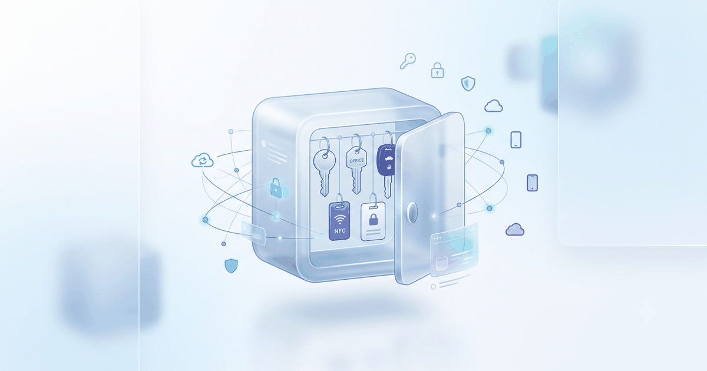

# Clavium, page de présentation

**Chaque clé à sa place, chaque sortie à un nom.**

Un crochet vide. Personne ne sait qui a pris la clé, ni depuis quand. Le cahier de sortie n'est plus rempli, l'étiquette est effacée. Clavium reproduit l'armoire à l'écran : chaque trousseau sur son crochet, chaque sortie au nom de celui qui l'emprunte, chaque retour daté.

Ce dépôt contient la page de présentation de Clavium, armoire à clés numérique destinée aux communes, à l'attention des élus et de la direction.

  
  

## Ce que présente la page

| Rubrique | Contenu |
|:--|:--|
| Voir | 70 crochets numérotés sur 2 portes : trousseaux de bâtiment en or, clés de baie informatique en vert |
| Suivre | Un trousseau décroché laisse un ticket : nom de la personne, date et heure de sortie |
| Identifier | Une fiche par trousseau, avec ses clés, ses codes, son historique et un QR code à imprimer pour le porte-clés |
| Organiser | Un nom, un type, un numéro de crochet, puis les clés une à une |
| Contrôler | 2 niveaux d'accès : administrateur et accès limité |
| Sécuriser | Droits imposés par la base de données, comptes nominatifs vérifiés par le serveur, QR code qui n'ouvre rien sans connexion, historique par trousseau |

## Principes

- Aucun cookie, aucun traceur, aucune publicité.
- Polices hébergées sur le site lui-même : aucune requête vers un service tiers.
- Captures réalisées avec des données entièrement fictives.
- Page non référencée par les moteurs de recherche.

## Technique

Page statique en HTML, CSS et JavaScript, sans dépendance, hébergée sur GitHub Pages. Polices Fraunces, Manrope et JetBrains Mono sous licence SIL Open Font License 1.1 (voir `fonts/OFL.txt`).

---

Clavium, projet d'Anthropotech Lab. Conçu et développé par Shams &amp; Dean. 
© 2026 Shams Guettaf, Anthropotech Lab. Tous droits réservés. Voir <a href="LICENSE">LICENSE</a> et les <a href="https://shamsetdean.github.io/clavium-presentation/mentions-legales.html">mentions légales</a>.
